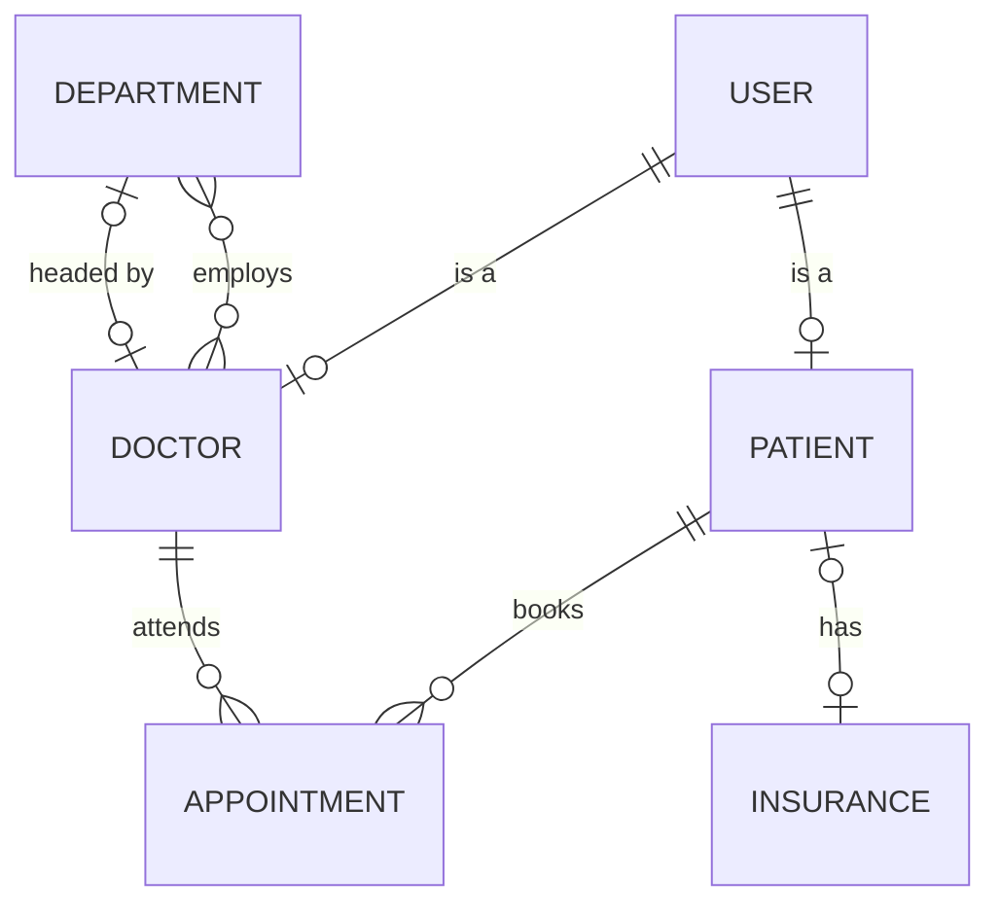

# 🏥 Hospital Management System

A secure, role-based **REST API backend** for managing hospital operations — patients, doctors, appointments and insurance — built with **Spring Boot 3**, **Spring Data JPA**, **PostgreSQL** and **JWT + OAuth2 authentication**.


## 📌 Overview

Hospitals deal with a lot of moving parts: who the patients are, which doctors are available, who is allowed to see or change what. This project models that domain as a layered Spring Boot application with a clean separation between controllers, services, repositories and DTOs, and protects every endpoint with **stateless JWT authentication** and **fine-grained role & permission based authorization**.

## ✨ Features

- **Authentication**
  - Email/password sign-up and login with BCrypt-hashed passwords
  - Stateless **JWT** access tokens (10-minute expiry)
  - **OAuth2 social login** via Google and GitHub, with automatic account creation on first login
- **Role-Based Access Control (RBAC)** with three roles — `ADMIN`, `DOCTOR`, `PATIENT` — mapped to granular permissions (`appointment:read`, `appointment:write`, `patient:read`, …)
- **Method-level security** using `@PreAuthorize` / `@Secured` (e.g. a doctor can only view *their own* appointments)
- **Patient management** — paginated patient listing for admins, blood-group enum, unique name + birth-date constraint, indexed queries
- **Doctor onboarding** — admins promote an existing user to a doctor with a specialization
- **Appointment booking** — patients book appointments with a doctor; doctors view their schedule
- **Insurance** — one-to-one insurance policy linked to a patient (assign / disassociate)
- **Departments** — many-to-many relationship between departments and doctors, with an optional head doctor
- **Centralised error handling** with `@RestControllerAdvice` returning consistent JSON error responses (401 / 403 / 404 / 500)
- **DTO mapping** with ModelMapper so entities are never exposed directly
- **Custom JPA queries** — JPQL, native queries with pagination, `JOIN FETCH` to avoid N+1, `@Modifying` updates, and aggregate projections (patients per blood group)

## 🛠️ Tech Stack

| Layer | Technology |
|-------|------------|
| Language | Java 21 |
| Framework | Spring Boot 3.5.3 (Web, Data JPA, Security, OAuth2 Client) |
| Database | PostgreSQL |
| ORM | Hibernate / Spring Data JPA |
| Auth | JWT (jjwt 0.12.6), OAuth2 (Google, GitHub) |
| Utilities | Lombok, ModelMapper |
| Build Tool | Maven (wrapper included) |
| Testing | JUnit 5, Spring Boot Test |

## 🗂️ Project Structure

```
src/main/java/com/codingshuttle/youtube/hospitalManagement
├── config/         # Application beans (ModelMapper, etc.)
├── controller/     # REST controllers (Auth, Admin, Doctor, Patient, Public)
├── dto/            # Request / response objects
├── entity/         # JPA entities + enums (RoleType, PermissionType, BloodGroupType, ...)
├── error/          # ApiError + GlobalExceptionHandler
├── repository/     # Spring Data JPA repositories
├── security/       # JWT filter, AuthService, OAuth2 handler, security config, role→permission map
└── service/        # Business logic (Appointment, Doctor, Patient, Insurance)
```

## 🧩 Data Model



## 🔐 Roles & Permissions

| Role | Permissions |
|------|-------------|
| **PATIENT** | `patient:read`, `appointment:read`, `appointment:write` |
| **DOCTOR** | `patient:read`, `appointment:read`, `appointment:write`, `appointment:delete` |
| **ADMIN** | all of the above + `patient:write`, `user:manage`, `report:view` |

## 🚀 Getting Started

### Prerequisites

- JDK 21+
- PostgreSQL 14+ running locally
- (Optional) Google / GitHub OAuth2 credentials for social login

### 1. Clone the repository

```bash
git clone https://github.com/Dhruvyadav27/hospital-management-system.git
cd hospital-management-system
```

### 2. Create the database

```sql
CREATE DATABASE "hospitalDB";
```

### 3. Configure environment variables

Secrets are read from environment variables — never commit them.

| Variable | Description |
|----------|-------------|
| `DB_USERNAME` | PostgreSQL username |
| `DB_PASSWORD` | PostgreSQL password |
| `JWT_SECRET` | Long random string (32+ characters) used to sign JWTs |
| `GOOGLE_CLIENT_ID` / `GOOGLE_CLIENT_SECRET` | Google OAuth2 credentials *(optional)* |
| `GITHUB_CLIENT_ID` / `GITHUB_CLIENT_SECRET` | GitHub OAuth2 credentials *(optional)* |

```bash
# Linux / macOS
export DB_USERNAME=postgres
export DB_PASSWORD=your_password
export JWT_SECRET=$(openssl rand -base64 48)
```

> For OAuth2, set the redirect URI to `http://localhost:8080/api/v1/login/oauth2/code/{google|github}` in the provider's console.

### 4. Run the application

```bash
./mvnw spring-boot:run
```

The API is now available at **`http://localhost:8080/api/v1`**.

> ⚠️ `spring.jpa.hibernate.ddl-auto` is set to `create`, so tables are **dropped and recreated on every start**. Change it to `update` if you want to keep data between runs.

### 5. Run the tests

```bash
./mvnw test
```

Tests need the PostgreSQL database from step 2 to be reachable.

## 📡 API Reference

Base URL: `http://localhost:8080/api/v1`

| Method | Endpoint | Access | Description |
|--------|----------|--------|-------------|
| `POST` | `/auth/signup` | Public | Register a new user (also creates a patient profile) |
| `POST` | `/auth/login` | Public | Login and receive a JWT |
| `GET` | `/oauth2/authorization/{google\|github}` | Public | Start the OAuth2 login flow |
| `GET` | `/public/doctors` | Public | List all doctors |
| `POST` | `/patients/appointments` | `PATIENT` | Book an appointment with a doctor |
| `GET` | `/doctors/appointments` | `DOCTOR`, `ADMIN` | List the logged-in doctor's appointments |
| `GET` | `/admin/patients?page=0&size=10` | `ADMIN` | Paginated list of all patients |
| `POST` | `/admin/onBoardNewDoctor` | `ADMIN` | Promote an existing user to a doctor |

Protected endpoints expect the header `Authorization: Bearer <token>`.

### Example requests

**Sign up**
```bash
curl -X POST http://localhost:8080/api/v1/auth/signup \
  -H "Content-Type: application/json" \
  -d '{"username":"jane@example.com","password":"secret123","name":"Jane Doe","roles":["PATIENT"]}'
```

**Login**
```bash
curl -X POST http://localhost:8080/api/v1/auth/login \
  -H "Content-Type: application/json" \
  -d '{"username":"jane@example.com","password":"secret123"}'
# → { "jwt": "<token>", "userId": 1 }
```

**Book an appointment** (as a patient)
```bash
curl -X POST http://localhost:8080/api/v1/patients/appointments \
  -H "Authorization: Bearer <token>" \
  -H "Content-Type: application/json" \
  -d '{"doctorId":1,"patientId":1,"appointmentTime":"2026-12-01T10:30:00","reason":"General checkup"}'
```

**Onboard a doctor** (as an admin)
```bash
curl -X POST http://localhost:8080/api/v1/admin/onBoardNewDoctor \
  -H "Authorization: Bearer <admin-token>" \
  -H "Content-Type: application/json" \
  -d '{"userId":2,"name":"Dr. Rakesh Mehta","specialization":"Cardiology"}'
```

> The first admin user has to be assigned the `ADMIN` role directly in the database.

## 🔮 Roadmap

- [ ] Resolve the patient profile (`GET /patients/profile`) from the authenticated user
- [ ] Endpoints to cancel / reschedule appointments and manage departments and insurance
- [ ] Database migrations with Flyway instead of `ddl-auto=create`
- [ ] API documentation with Swagger / OpenAPI
- [ ] Refresh tokens and configurable token expiry
- [ ] Dockerfile + `docker-compose` for one-command setup
- [ ] Integration tests for the security layer

## 🙏 Acknowledgements

Built while learning Spring Boot Data JPA and Spring Security from the **Coding Shuttle** Spring Boot course, and extended from there.

## 👤 Author

[@Dhruvyadav27](https://github.com/Dhruvyadav27)

---

⭐ If you found this project useful, consider giving it a star!
